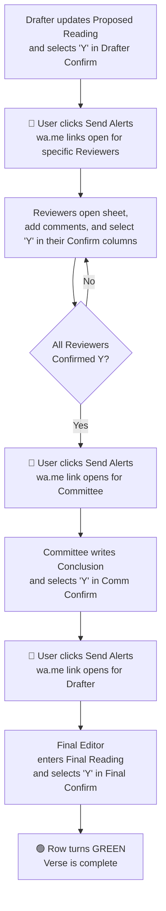

# GLBC Translation System — Setup Guide

> [!IMPORTANT]
> Complete these steps **in order**. The whole setup takes about 15–20 minutes.

---

## What the Script Does

---

## Step 1 — Create the Google Sheet

1. Go to [sheets.google.com](https://sheets.google.com) → **Blank spreadsheet**
2. Rename the first tab (bottom) to **`Romans`** (or your book name)
3. Save the sheet URL — you'll share this with your team later

---

## Step 2 — Open Apps Script

1. In your Google Sheet, click **Extensions → Apps Script**
2. A new browser tab opens with a code editor
3. Delete everything in the editor (there's a default `function myFunction() {}`)

---

## Step 3 — Paste the Script

1. Open the file: `Code.gs` from this project
2. **Copy the entire contents**
3. Paste it into the Apps Script editor
4. Press **Ctrl+S** to save
5. Name the project `GLBC Translation` when prompted

---

## Step 4 — Run First Setup (Format Translation Sheet)

1. Go back to your Google Sheet (refresh the tab)
2. You'll see a new menu: **📖 GLBC** in the top menu bar
3. Click **📖 GLBC → 1️⃣ Format Translation Sheet**
4. A permission dialog will appear — click **Allow**
5. Your sheet will get color-coded headers, frozen rows, specific review columns, and "Y/N" drop-downs.

---

## Step 5 — Create the Config Sheet

1. Click **📖 GLBC → 2️⃣ Create Config Sheet**
2. A new tab called **⚙ Config** appears
3. You'll see sample team data — **replace it with your real team**

### Fill in your team:

| Column | What to enter |
|--------|--------------|
| **A — Name** | Person's full name |
| **B — Role** | Must be exactly: `Drafter`, `Technical Reviewer`, `Style & Language Reviewer`, `Orthographic Reviewer`, `Theological Reviewer`, `Committee`, or `Final Editor` |
| **C — Phone** | Phone with country code, **no + sign** (e.g. `919876543210`) |
| **D — Google Email** | The user's Google account email. **(Critical for column protections)** |
| **E — Active** | `Yes` or `No` |

> [!NOTE]
> The system now uses standard WhatsApp (`wa.me`) click-to-chat links! No API Keys are required.

---

## Step 6 — Protect Columns by Role

To ensure reviewers don't overwrite each other's work, the script can automatically lock columns so only the assigned person (and the Sheet Owner) can edit them.

1. Ensure you have entered everyone's **Google Email** in the Config Sheet.
2. Ensure you have Shared the document with them (click Share -> Add their emails).
3. Click **📖 GLBC → 🛡️ Apply Column Protections by Role**
4. The script will automatically lock the Technical Review columns to the Technical Reviewer, the Style columns to the Style Reviewer, and so on.

---

## Step 7 — How to Send WhatsApp Alerts

There are no background triggers. When you want to notify the team that a stage is ready:

1. Click on the row you want to send an alert for.
2. Click **📖 GLBC → 📨 Send Alerts for Current Row**.
3. A popup will appear analyzing the row's confirmations. It will show exactly who needs to act next.
4. Click the green **Send to [Name]** buttons. This opens WhatsApp Web or your phone's WhatsApp app with a pre-filled message.

---

## Step 8 — Migrate Your Existing Excel Data

1. Open your existing source data.
2. Copy the data rows (not the header) and match them to the new specific columns.
3. Paste them into Row 2 of your Google Sheet.
4. Click **📖 GLBC → 🔄 Refresh All Status Colors**
5. All rows will auto-color based on how complete they are.

> [!TIP]
> The status column (Col A) updates automatically based on the 'Y/N' confirmations:
> - `🔴 Not Started` — Drafter hasn't confirmed 'Y' yet.
> - `🟡 Awaiting Review` — Drafter confirmed, reviewers haven't.
> - `🟡 Under Review` — Some reviewers confirmed, but not all.
> - `🟡 Awaiting Committee` — All 4 reviewers confirmed 'Y'.
> - `🟡 Needs Final` — Committee confirmed 'Y'.
> - `✅ Done` — Final Reading entered.

---

## Step 9 — Drafter Document Import & Template (with Colors & Highlights)

Drafters often prepare their translations and color-coded back-translation notes in Word documents using font colors and text highlights. Because Google Sheets does not support character-level background highlights inside cells, the import system automatically converts **Highlight Colors** (e.g. Yellow, Green, Cyan, Magenta) directly into **Bold Colored Text** in the sheet, ensuring full visual fidelity:

### A. One-Time Authorization
Because importing interacts with Google Drive and Google Docs, you must grant permissions once:
1. Click **📖 GLBC → 🔑 Authorize Import Feature (run once)**.
2. A Google authorization dialog will appear — click **Continue**, select your account, click **Advanced**, then **Go to GLBC Translation (unsafe)**, and **Allow**.
3. A confirmation popup `✅ Authorization Complete!` will display.

### B. Download the Word Template
1. Click **📖 GLBC → 📄 Download Drafter Template**.
2. A pre-formatted `.docx` template will download automatically with the required section labels (`Old Reading (KJV):`, `Proposed Reading:`, `Drafter Comments:`) and sample back-translation table. Share this template with your drafters.

### C. Upload & Import Process
1. Have drafters upload their completed Word doc to a shared Google Drive folder.
2. In Google Drive, open the uploaded `.docx` file with Google Docs, then click: **File → Save as Google Docs** (this creates the native Google Doc and removes the blue `[.DOCX]` compatibility badge).
3. Copy the **Folder ID** from your browser URL (the alphanumeric string after `/folders/`).
4. In your translation book tab (e.g. `Romans`), click **📖 GLBC → 📥 Import Drafter Doc**.
5. Paste the Folder ID and click **Next**.
6. Review the detected verses (with conflict indicators if a row already has data), select the verses you want to import, and click **✅ Import Selected**.
7. The verses, tables, font colors, and highlights (converted to bold colored text) will populate into Columns C, D, and E, and the processed document in Drive will be cleared automatically.

---

## Column Reference Card (share this with the team)

| Column | Who fills it | What is it |
|--------|-------------|------|
| **A-C** | Admin | Status, Verse, KJV Text |
| **D-F** | Drafter | Proposed Reading, Comments, and **Confirm (Y/N)** |
| **G-H** | Tech Reviewer | Technical Review notes and **Confirm (Y/N)** |
| **I-J** | Style Reviewer | Style & Language Review notes and **Confirm (Y/N)** |
| **K-L** | Ortho Reviewer | Orthographic Review notes and **Confirm (Y/N)** |
| **M-N** | Theo Reviewer| Theological Review notes and **Confirm (Y/N)** |
| **O-P** | Committee | Committee Conclusion notes and **Confirm (Y/N)** |
| **Q-R** | Final Editor | Final Reading and **Confirm (Y/N)** |

---

## Troubleshooting

| Problem | Fix |
|---------|-----|
| Error: Authorization is required to perform that action | Click **📖 GLBC → 🔑 Authorize Import Feature (run once)** and click **Allow** on Google's permission popup. |
| No Google Docs found in this folder | Open the Word file in Google Docs, and click **File → Save as Google Docs** (so the blue [.DOCX] badge disappears). |
| WhatsApp link broken | Check phone number in Config has no spaces or `+`. Format: `91XXXXXXXXXX` |
| Wrong people showing in alert popup | Ensure the previous stage is fully confirmed with "Y" in the Confirm columns. |
| Cannot edit my column | Check that your Google Email matches the Config sheet exactly, and ask the Admin to run `🛡️ Apply Column Protections by Role` again. |
| No GLBC menu | Refresh the spreadsheet tab. |
| Script permission error | Run any menu function → click **Allow** on the Google permissions popup |
