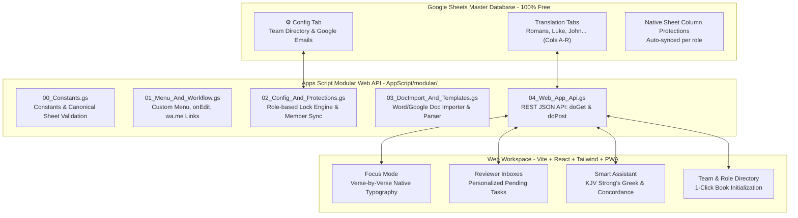

# Regional Translation OS — Deployment & White-Label Guide
**A Modern, Decoupled Translation Workspace Built on Headless Google Sheets**  
*Empowering Regional Bible Societies with a $0/Month Infrastructure*

---

## 1. Executive Summary

**Regional Translation OS** is a workflow and review operating system designed for regional Bible translation bodies (e.g. Kannada, Tamil, Telugu, Hindi, Malayalam, Marathi, Bengali, Odia, Gujarati, Assamese, Punjabi).

Translators and reviewers often suffer from **Google Sheets fatigue**:
- Horizontal scrolling across 18 wide columns.
- Clunky multi-line Indic scripts in small spreadsheet cells.
- Lack of individual pending task queues for specialized reviewers.
- No instant mobile-friendly Greek/Hebrew concordances.

Regional Translation OS solves this by **decoupling the presentation layer from the database**:
- **Master Database ($0/month)**: Google Sheets remains the master database, audit trail, and master source of truth.
- **Frontend Workspace ($0/month)**: A modern, ultra-fast React + Vite + PWA web application hosted on Vercel or Cloudflare Pages, giving reviewers **Focus Mode** (1 verse at a time), instant 1-tap approvals, threaded discussion notes, and authentic Strong's Greek Concordance.

---

## 2. System Architecture

---

## 3. The 18 Canonical Columns

Every translation book sheet utilizes the standardized 18-column workflow schema:

| Col | Letter | Field Name | Description | Access Role |
|:---:|:---:|:---|:---|:---|
| 1 | **A** | **Status** | Auto-calculated stage label & background color | Read-only |
| 2 | **B** | **Verse Ref** | Canonical reference (e.g., `Rom 1:1`) | Read-only |
| 3 | **C** | **Old Reading (KJV)** | Historical translation baseline / KJV English | Read-only |
| 4 | **D** | **Proposed Reading** | New draft translation in regional language | Drafter |
| 5 | **E** | **Drafter Comments** | Back-translations, tables, lexical notes | Drafter |
| 6 | **F** | **Drafter Confirm** | `Y` / `N` confirmation | Drafter |
| 7 | **G** | **Technical Review** | Technical review notes & bylines | Technical Reviewer |
| 8 | **H** | **Tech Confirm** | `Y` / `N` confirmation | Technical Reviewer |
| 9 | **I** | **Style & Language Review** | Stylistic and dialect observations | Style & Language Reviewer |
| 10 | **J** | **Style Confirm** | `Y` / `N` confirmation | Style & Language Reviewer |
| 11 | **K** | **Orthographic Review** | Spelling, grammar, conjuncts, punctuation | Orthographic Reviewer |
| 12 | **L** | **Ortho Confirm** | `Y` / `N` confirmation | Orthographic Reviewer |
| 13 | **M** | **Theological Review** | Doctrinal consistency and theological fidelity | Theological Reviewer |
| 14 | **N** | **Theo Confirm** | `Y` / `N` confirmation | Theological Reviewer |
| 15 | **O** | **Committee Conclusion** | Editorial board consensus findings | Committee |
| 16 | **P** | **Comm Confirm** | `Y` / `N` confirmation | Committee |
| 17 | **Q** | **Final Reading** | Published text authorized by Final Editor | Final Editor |
| 18 | **R** | **Final Confirm** | Locks row permanently when set to `Y` | Final Editor |

---

## 4. 5-Minute Quick-Start Deployment Guide

### Step 1: Create Google Spreadsheet
1. Go to [Google Sheets](https://sheets.new) and create a new blank spreadsheet.
2. Name it (e.g. `Tamil Bible Translation Workspace` or `GLBC Translation`).

### Step 2: Paste Modular Google Apps Script Files
1. In Google Sheets, click **Extensions → Apps Script**.
2. Create 5 script files matching `AppScript/modular/`:
   - `00_Constants.gs`
   - `01_Menu_And_Workflow.gs`
   - `02_Config_And_Protections.gs`
   - `03_DocImport_And_Templates.gs`
   - `04_Web_App_Api.gs`
3. Copy and paste the code from each respective file in this repository.
4. Save the project (Ctrl+S / Cmd+S).

### Step 3: Initialize Configuration & Permissions
1. Refresh your Google Spreadsheet tab. A new menu item **📖 GLBC** will appear in the top menu bar.
2. Click **📖 GLBC → 2️⃣ Create Config Sheet**.
   - This creates the `⚙ Config` sheet with predefined team member headers.
3. In `⚙ Config`, enter the actual names and **Google Account emails** of your translation team.
4. Click **📖 GLBC → ⚡ Enable Auto-Sync Protections**.
   - This sets up the automatic background trigger so whenever a coordinator adds, updates, or deactivates a team member in `⚙ Config`, column permissions across all translation books are automatically updated!

### Step 4: Deploy the Web App JSON API
1. In the Apps Script editor, click the blue **Deploy → New deployment** button at the top right.
2. Select type: **Web app**.
3. Fill in the deployment settings:
   - **Description**: `Regional Translation OS v1.0`
   - **Execute as**: `Me (your email)`
   - **Who has access**: `Anyone` *(Note: This allows the decoupled React frontend to send requests securely without requiring complex OAuth client credentials)*.
4. Click **Deploy** and authorize permissions when prompted.
5. Copy the generated **Web App URL** (starts with `https://script.google.com/macros/s/.../exec`).

### Step 5: Deploy Frontend Web App (Vercel or Cloudflare Pages)
1. Fork or clone this repository.
2. Deploy to [Vercel](https://vercel.com) (or Cloudflare Pages / Netlify) for free ($0/month):
   - **Root Directory**: `web`
   - **Build Command**: `npm run build`
   - **Output Directory**: `dist`
   - **Environment Variable**: `VITE_APPS_SCRIPT_URL = <paste your Web App URL>`
3. Open your deployed web application URL.
4. Click the connection pill in the top bar to verify the green `● Live Sheet Connected` status!

---

## 5. White-Labeling for Other Regional Languages

### 1. Typography & Indic Fonts
To customize the web workspace for other regional languages:
- **Kannada**: `Noto Sans Kannada` (pre-configured)
- **Tamil**: `Noto Sans Tamil`
- **Telugu**: `Noto Sans Telugu`
- **Hindi / Marathi / Sanskrit**: `Noto Sans Devanagari`
- **Malayalam**: `Noto Sans Malayalam`
- **Bengali / Assamese**: `Noto Sans Bengali`
- **Gujarati**: `Noto Sans Gujarati`

Simply update the Google Font link in `web/index.html` and Tailwind font family configuration in `web/tailwind.config.js`.

### 2. Multi-Book Expansion via 1-Click Wizard
Translators never need to manually create 18 columns in Google Sheets:
1. In the web app, click the **Book Selector** at the top (`Romans ▾`).
2. Select any canonical book of the Old or New Testament (e.g. *Luke*, *John*, *Galatians*).
3. The app opens in **Reference & Study Mode**, providing authentic KJV verses, Greek Textus Receptus, and concordance hints.
4. Click the blue button: **[ ⚡ Initialize {Book} in Google Sheets ]**.
5. The system automatically creates the new book tab in Google Sheets, formats the 18 colored headers, sets up Y/N validation dropdowns, locks column protections, and refreshes the web view into active translation mode!

### 3. Team & Role Directory Management
Coordinators can manage translators without opening Google Sheets:
1. Click the **[ 👥 Team ]** button in the top navigation bar.
2. View all members, search by role or language discipline, and toggle active/inactive status.
3. Add multi-role members (e.g. a scholar serving as both *Theological Reviewer* and *Committee Member*).
4. Click **[ Sync Protections ]** to instantly lock Google Sheets columns to assigned Google Account emails.

---

## 6. Security, Privacy & Data Sovereignty

- **Data Sovereignty**: All translation data, drafter notes, and reviewer discussions live entirely inside **your own Google Drive and Google Sheets account**. No external databases or third-party cloud storage services are used.
- **Role Isolation**: Native Google Sheets range protections prevent reviewers from modifying drafter text or each other's discipline notes.
- **Finalized Verse Immutability**: Once the Final Editor marks Column R as `"Y"`, the row is locked permanently.
- **WhatsApp Integration**: Generated `wa.me` links run purely on client-side URL encoding with deep-linking back to the exact verse card. No WhatsApp Business API costs or third-party messaging middleware required.

---

*Regional Translation OS is released for regional translation bodies and Bible societies worldwide.*
